### Building search, database and AI systems that keep working when parts of them fail.

B.Tech Information Technology student in Chennai, India. Open to SDE internships.

[Featured projects](#featured-projects) · [Tech stack](#tech-stack) · [Portfolio](https://mdarafath202006-tech.github.io/Mohamed-Arafath-Portfolio/) · [Résumé](https://mdarafath202006-tech.github.io/Mohamed-Arafath-Resume/) · [Contact](#contact)

I'm an IT undergraduate who prefers building systems to building demos. My projects include a search engine with BM25 ranking, a database engine with write-ahead logging, a RAG backend, a network-security compliance platform, and a Flask platform with seven Claude-powered career tools. I start from how a system should behave when something breaks, write the trade-offs down, then build to them.

If you open one repository first, make it **AI CareerVerse**. It has the tests, CI pipeline and Docker setup.

## About

- **Studying:** B.Tech, Information Technology at St. Peter's College of Engineering and Technology, Chennai (expected May 2028)
- **Focus:** databases and storage engines, search infrastructure, retrieval-augmented generation, security tooling
- **Approach:** fallback paths before happy paths, explicit trade-offs, and reading PostgreSQL, Lucene and LevelDB internals to guide design
- **Looking for:** SDE internships
- **Worth a click:** my [portfolio](https://mdarafath202006-tech.github.io/Mohamed-Arafath-Portfolio/) background is a small cluster. Fail a node and watch it recover.

## Featured projects

### AI CareerVerse

*A career platform that connects students with alumni, mentors and job opportunities, with AI tools for resumes, interviews and roadmaps.*

- **Mentorship and referrals:** skill-based alumni recommendations, request and accept/decline flows, referral requests with approve/reject status, and real-time Socket.IO notifications
- **Seven Claude-powered tools:** career chat, resume analyzer (ATS score) and builder, job match, skill-gap analyzer, career roadmap, and interview coach
- **Platform features:** job portal, company pages, a knowledge base of interview experiences and career guides, social feed, communities, follows, and an admin dashboard
- **Why it's interesting:** three user roles (student, alumni, admin), CSRF protection, Redis-backed rate limiting, pytest tests, a GitHub Actions workflow, and Docker plus a Render blueprint. It's structured like a product, not a single-feature demo.

**Stack:** Python · Flask · SQLAlchemy · PostgreSQL · Redis · Flask-SocketIO · Gunicorn · Claude API · Docker · GitHub Actions

[Repository](https://github.com/mdarafath202006-tech/aicareerverse) · Runs locally with seeded demo data (setup is in the repo README)

### Nexus-Comply AI

*A multi-vendor network security compliance and risk platform that turns Cisco, Fortinet and Juniper configurations into one vendor-neutral model.*

- Automatic vendor detection and normalization of Cisco IOS, Fortinet FortiOS and Juniper Junos configs
- Deterministic rules mapped to CIS, NIST, STIG and ISO, with evidence-backed findings and contextual risk scoring
- Cross-device security graph, JWT role-based access and PDF audit reports
- Built for Smart India Hackathon (SIH26155)

**Stack:** Python · FastAPI · React · TypeScript · PostgreSQL · Docker

[Repository](https://github.com/mdarafath202006-tech/nexus-comply-ai)

### Systems and infrastructure

- **[Retrivix](https://github.com/mdarafath202006-tech/Retrivix)**: a local Python search engine with document ingestion, tokenization, an inverted index, persisted indexes and top-K BM25 ranking.
- **[VirelyxDB](https://github.com/mdarafath202006-tech/VirelyxDB)**: a Python relational-storage prototype with schema validation, JSON persistence, equality indexes, CRUD operations and a snapshot-based write-ahead-log recovery demo.
- **[Loreva](https://github.com/mdarafath202006-tech/Loreva)**: a FastAPI RAG prototype that chunks documents, retrieves passages with BM25-style lexical scoring and returns source-grounded extractive answers. Embeddings and LLM synthesis are planned extensions.

### Archived

- **[AlumniConnect](https://github.com/mdarafath202006-tech/alumniconnect)**: an earlier Flask and MySQL mentorship prototype (TF-IDF mentor ranking, Socket.IO chat, JWT API). Archived in October 2026; its ideas continue in AI CareerVerse.

## Tech stack

Technologies I've used in the projects above. Where I'm still early, I say so.

**Languages**

**Backend and APIs**

**Databases**

**AI and retrieval:** LLM applications (Claude API), RAG, embeddings, vector search, BM25 and inverted indexes, recommendation systems

**Tooling**

**Exploring:** gRPC, Azure AI Foundry (Microsoft Virtual Training Day: Build Agentic AI Solutions)

## Currently building and learning

- **Locatrix** (prototype): offline dead-reckoning simulation with heading fusion and CRC-protected location packets; real phone-sensor integration and Bluetooth/LoRa transport remain future work.
- **Studying:** database internals, search infrastructure, and distributed-systems trade-offs

## Contact

Open to SDE internships. Email is the fastest way to reach me.

